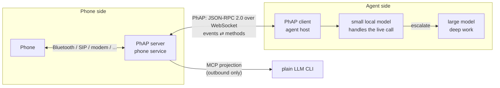
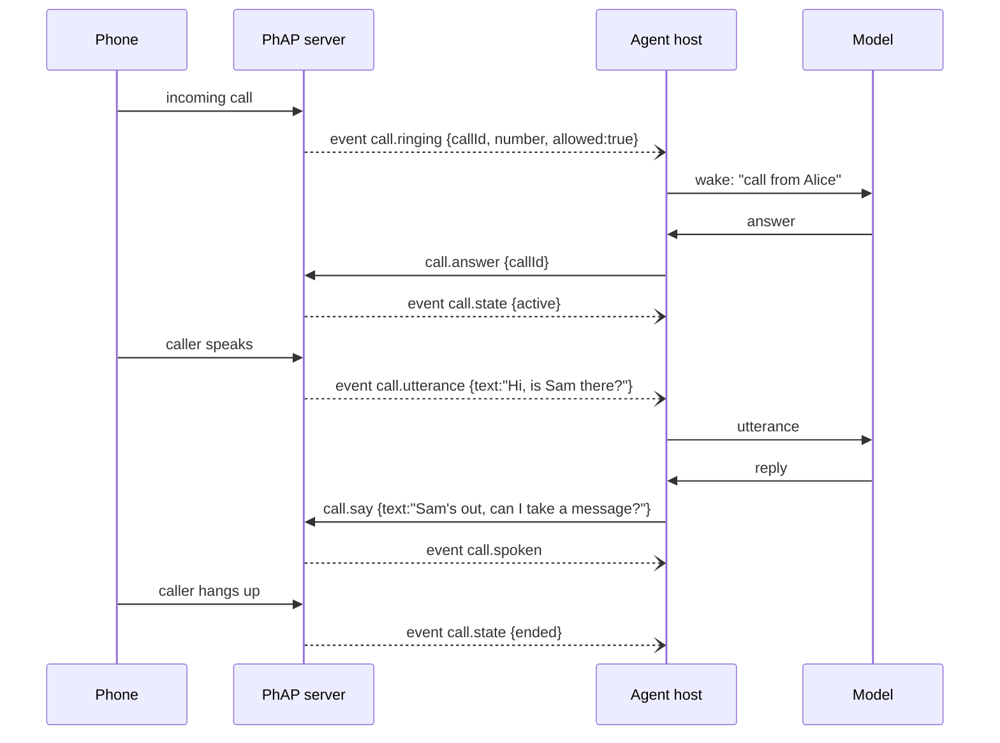
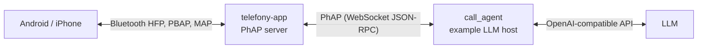

# PhAP: Phone Agent Protocol

**An open protocol that lets AI agents use a real phone:** place and answer calls, hold a live spoken conversation, run conference calls, send and read SMS, and search contacts.

> **Status:** Draft, still in development, protocol revision `2026-10-27`. Breaking changes are possible until the first stable revision; YMMV.
>
> 📄 **Specification:** [`spec/2026-10-27/index.md`](spec/2026-10-27/index.md) · 🧩 **JSON Schema:** [`schema/2026-10-27/schema.json`](schema/2026-10-27/schema.json) · 📝 [Changelog](CHANGELOG.md)

> **Sample implementation:** [telefony-app](https://github.com/PetePeter/telefony-app), a PhAP server for Android/iPhone over Bluetooth, plus an example LLM host that answers calls with it.

---

> ℹ️ **Note:** PhAP is unrelated to Visa's *Trusted Agent Protocol* (TAP).

## Why PhAP?

The [Model Context Protocol (MCP)](https://modelcontextprotocol.io) is a good fit for giving an LLM *tools*. Tools are request/response, though, and the LLM is always the caller.

A phone doesn't work that way:

- **It rings.** Something outside the agent starts the interaction, often while the agent is idle.
- **Calls are live.** Speech arrives continuously, the agent replies, and the call keeps going even if the agent stops thinking about it.
- **State outlives the client.** A call doesn't hang up because an agent process restarted.
- **The stakes are real.** Phoning or texting the wrong number costs money and trust, so safety has to be enforced on the phone side, not left to the model.

If you poll for events over MCP, an idle LLM burns tokens just waiting for the phone to ring. PhAP turns this around. The **phone service pushes events** to an **agent host**, the host decides which model (if any) should deal with them, and that model drives the call through a small, typed set of methods.



## Design in one paragraph

PhAP is **JSON-RPC 2.0 over a WebSocket**.
- **Handshake:** the client opens with `hello` (`protocolVersion`, token, role) and gets back `welcome` (capabilities, a snapshot of the current state, the last event sequence number).
- **Events:** the server then streams numbered events such as `call.ringing`, `call.state`, `call.utterance` and `sms.received`.
- **Methods:** the client calls methods such as `call.dial`, `call.say`, `call.hangup`, `conference.create` and `sms.send`.
- **Recovery:** a client that reconnects asks to resume from the last `seq` it saw.

The server is the **only** place the number allowlist is enforced. Its configuration can't be changed over the protocol, so an agent can't widen its own permissions.

## Core concepts

| Concept | Summary |
|---|---|
| **Server** | Owns the phone: the radio or link, audio, speech-to-text and text-to-speech, the allowlist. One per phone. |
| **Client / host** | An agent runtime (for example the [sample call agent](#reference-implementations), or Helm). It picks which model handles what. |
| **Controller / observer** | One controller may change state. Any number of observers may watch. |
| **Events** | Notifications pushed by the server, each with a `seq` for resume. |
| **Methods** | Typed requests. Those that change state are idempotent per request `id` for 60 s. |
| **Capabilities** | `calls`, `conference`, `sms`, `contacts`, `voice`. A server advertises what it supports. |
| **Fallback policy** | What happens when nobody answers a ringing call (`ring` or `reject`). |

## A call, end to end



## Example frames

```jsonc
// client → server
{"jsonrpc":"2.0","id":1,"method":"hello",
 "params":{"protocolVersion":"2026-10-27","token":"…","role":"controller",
           "clientInfo":{"name":"my-host","version":"1.0.0"},"resumeFrom":41}}

// server → client
{"jsonrpc":"2.0","id":1,"result":{"protocolVersion":"2026-10-27",
 "serverInfo":{"name":"telefony-app","version":"0.1.0"},
 "capabilities":{"calls":{},"sms":{},"contacts":{},"voice":{"tts":true,"stt":true}},
 "role":"controller","state":{"link":"up","engine":"ready","calls":[]},"lastSeq":57,"gap":false}}

// server → client (event)
{"jsonrpc":"2.0","method":"event",
 "params":{"seq":58,"ts":"2026-10-27T08:00:00Z","type":"call.ringing","callId":"c7","number":"+447700900123","allowed":true}}

// client → server
{"jsonrpc":"2.0","id":2,"method":"call.answer","params":{"callId":"c7"}}

// error
{"jsonrpc":"2.0","id":3,"error":{"code":1001,"message":"not_allowed"}}
```

## Methods at a glance

| Area | Methods |
|---|---|
| Calls | `call.dial`, `call.answer`, `call.reject`, `call.hangup`, `call.say`, `call.hold`, `call.resume` |
| Conference | `conference.create`, `conference.join` |
| SMS | `sms.send`, `sms.list`, `sms.read` |
| Contacts | `contacts.search` |
| Other | `transcript.get`, `engine.start`, `engine.stop`, `status` |

## Events at a glance

`link`, `engine`, `call.ringing`, `call.state`, `call.utterance`, `call.spoken`, `sms.received`, `heartbeat`

## Security model

- **Allowlist on the server.** Dialling, texting or conferencing a number that isn't allowlisted fails with `1001 not_allowed`, whichever protocol the request came in on.
- **Config fixed at startup.** No method changes the allowlist, the token or the policies.
- **Token auth.** Connections are rejected unless the first frame is a `hello` carrying the right token.
- **Localhost by default.** A remote bind requires TLS.
- **Untrusted content.** Caller speech, SMS bodies and contact names come from third parties. Hosts must treat them as *data*, never as instructions to the model. This is the main defence against prompt injection over the phone.

## PhAP and MCP

PhAP doesn't replace MCP. It complements it. A PhAP server can also expose an **MCP projection** for plain LLM CLIs, in which:
- `say` blocks until the speech has been played
- `listen(timeout)` blocks until the caller has said something or hung up

That's enough for a CLI to hold a turn-based call it placed itself. Inbound calls need an always-on host, and that's what PhAP is for.

| | PhAP | MCP projection |
|---|---|---|
| Inbound calls / SMS | ✅ pushed events | ❌ (no idle wake-up) |
| Outbound calls / SMS | ✅ | ✅ |
| Live conversation | ✅ event stream | ✅ turn-based `listen` / `say` |
| Resume after disconnect | ✅ `seq` replay | n/a |
| Multiple watchers | ✅ observers | ❌ |

## Versioning

- `protocolVersion` is a date string (`YYYY-MM-DD`) naming a revision of the specification, the same scheme MCP uses.
- The server either agrees to the requested revision or offers one it supports. If no common revision exists, it refuses with `1008 version_mismatch`.
- Within a revision, receivers must ignore unknown fields and event types.

## Reference implementations



| Project | Role | Status |
|---|---|---|
| **[telefony-app](https://github.com/PetePeter/telefony-app)** | Sample PhAP server. The PC acts as a Bluetooth hands-free unit for a real Android phone or iPhone (calls over HFP, contacts over PBAP, SMS over MAP), with local text-to-speech and speech-to-text. Every frame it sends is checked against the schema in its tests. | ✅ v0.1, tested on an iPhone |
| **call_agent** (in telefony-app `examples/`) | Example PhAP host: an LLM phone assistant that answers allowlisted callers, with time, weather, conference and SMS tools. The LLM names people from a phonebook and never sees a number. | ✅ v0.1 |
| **Helm** | PhAP client and agent host. Routes calls to a restricted local model and escalates to a larger model when needed. | 🚧 Planned |

## Roadmap

- [x] `2026-10-27` draft: calls, SMS, contacts, conference, resume, idempotency
- [x] JSON Schema for every frame
- [x] sample server and LLM host (telefony-app)
- [ ] conformance test suite
- [ ] `audio_stream` capability (raw PCM for speech-to-speech models)
- [ ] barge-in (interrupting `call.say`)
- [ ] multiple lines and phones per server

## Repository layout

```
spec/2026-10-27/      normative specification (start at index.md)
  basic/              messages, transports, lifecycle, authorization, utilities
  server/             calls, conference, sms, contacts, transcripts, engine
schema/2026-10-27/    JSON Schema (draft 2020-12)
```

## Acknowledgements

- The structure and conventions are inspired by the [Model Context Protocol](https://modelcontextprotocol.io) specification. These include date-based revisions, the split into base protocol and features, and capability negotiation. No text has been copied from it.
- PhAP builds on:
  - [JSON-RPC 2.0](https://www.jsonrpc.org/specification)
  - [WebSocket (RFC 6455)](https://www.rfc-editor.org/rfc/rfc6455)
  - the [RFC 2119](https://datatracker.ietf.org/doc/html/rfc2119) and [RFC 8174](https://datatracker.ietf.org/doc/html/rfc8174) key words
  - [JSON Schema 2020-12](https://json-schema.org/draft/2020-12)

## Contributing

Issues and pull requests on the spec are welcome. Please open an issue to discuss breaking changes before sending a PR.
