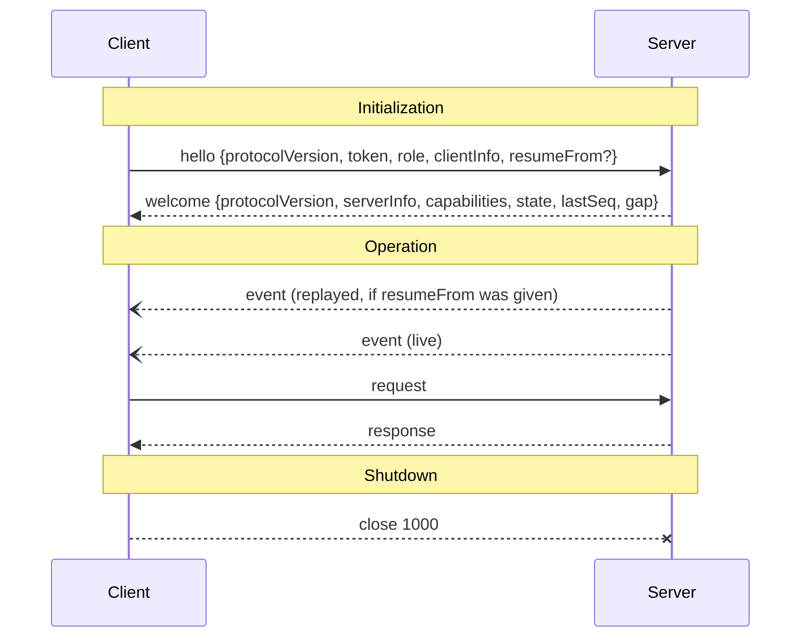

# Lifecycle

**Protocol Revision:** `2026-10-27`

A session has three phases:

1. **Initialization**: authentication, version negotiation, capability negotiation and role assignment.
2. **Operation**: requests, responses and events.
3. **Shutdown**: closing the connection.



## Initialization

### `hello`

The first message the client sends MUST be a `hello` request. If the server receives any other message first, it MUST close the connection with code `4400`.

```json
{
  "jsonrpc": "2.0",
  "id": 1,
  "method": "hello",
  "params": {
    "protocolVersion": "2026-10-27",
    "token": "s3cr3t",
    "role": "controller",
    "clientInfo": { "name": "helm", "version": "1.4.0" },
    "resumeFrom": 41
  }
}
```

| Param | Required | Description |
|---|---|---|
| `protocolVersion` | yes | The revision the client wishes to speak. |
| `token` | yes | Credential; see [Authorization](authorization.md). |
| `role` | yes | `"controller"` or `"observer"`. |
| `clientInfo` | yes | `{name, version}`. |
| `resumeFrom` | no | The last `seq` the client processed; see [Resumption](utilities/resumption.md). |

### `welcome` (the result of `hello`)

```json
{
  "jsonrpc": "2.0",
  "id": 1,
  "result": {
    "protocolVersion": "2026-10-27",
    "serverInfo": { "name": "telefony-app", "version": "0.1.0" },
    "capabilities": {
      "calls": {},
      "conference": {},
      "sms": {},
      "contacts": {},
      "voice": { "tts": true, "stt": true }
    },
    "role": "controller",
    "state": {
      "link": "up",
      "engine": "ready",
      "calls": [
        { "callId": "c1", "number": "+447700900123", "state": "active", "direction": "outbound" }
      ]
    },
    "lastSeq": 57,
    "gap": false
  }
}
```

The server MUST NOT send any event before it has sent the `welcome` response.

### Version Negotiation

- `protocolVersion` is a date string, `YYYY-MM-DD`, that identifies a revision of this specification.
- If the server supports the requested revision, it MUST respond with that same revision.
- Otherwise:
  - If the server supports another revision, it MAY respond with the latest revision it supports. The client MUST then either proceed with that revision or close the connection.
  - If the server cannot or will not do that, it MUST return error `1008` (`version_mismatch`), with `data.supported` listing the revisions it supports, and then close with code `4426`.

### Capability Negotiation

Capabilities are declared by the server only. Each key in `capabilities` names a feature, and its value is an object of feature-specific options.

| Capability | Feature |
|---|---|
| `calls` | [Calls](../server/calls.md) |
| `conference` | [Conference](../server/conference.md) |
| `sms` | [SMS](../server/sms.md) |
| `contacts` | [Contacts](../server/contacts.md) |
| `voice` | Speech recognition (`stt`) and synthesis (`tts`) within calls; required for `call.say` and `call.utterance` |

- `transcripts` and `engine` are part of the base feature set and are always available.
- A client MUST NOT invoke a method that belongs to an undeclared capability. If it does, the server MUST return `1006` (`unsupported`).
- The capability name `audio_stream` is reserved.

### Roles

- At most **one** controller session MAY exist at a time.
- If a `hello` requests `role: "controller"` while another controller session exists, the server MUST return `1004` (`busy`). The server MAY then close the connection with code `4409`, or it MAY keep the session open as an observer, in which case `welcome.role` MUST be `"observer"`.
- When the controller session ends, the controller slot becomes free immediately.
- Observers MAY invoke only methods that are not marked ✱. For any ✱ method, the server MUST return `1005` (`not_controller`).

### State Snapshot

`welcome.state` MUST describe the server's current state at the moment it sends `welcome`:

| Field | Values |
|---|---|
| `link` | `"up"` or `"down"` |
| `engine` | `"starting"`, `"ready"`, `"stopped"` or `"error"` |
| `calls` | Every call that has not reached `ended`, each as a `CallInfo` (see [Calls](../server/calls.md)) |

## Operation

- After `welcome`, both sides speak only the agreed revision, and the client confines itself to the declared capabilities.
- The server MUST deliver events in `seq` order.
- Responses MAY be interleaved with events in either order.

## Shutdown

- Either party MAY end the session by closing the WebSocket with code `1000`.
- Closing a session MUST NOT end, hold or otherwise affect any call. Calls are independent of sessions.
- A server that is itself shutting down SHOULD first emit an `engine` event with `status: "stopped"`, then close every session with code `1001`.
