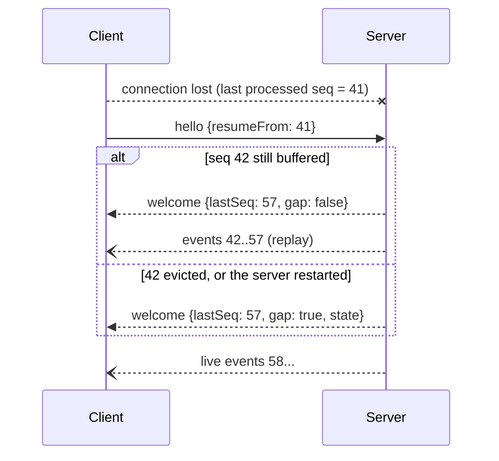

# Resumption

**Protocol Revision:** `2026-10-27`

Resumption lets a client that has reconnected receive the events it missed.

## Event Log

- The server MUST keep, in memory, the most recent `N` events it has emitted, where `N` ≥ 100. The RECOMMENDED value is 1000.
- `seq` values are unique and strictly increasing for the lifetime of a server process. They MAY restart at 1 when the process restarts.
- `welcome.serverInfo` SHOULD include an `instanceId` that changes on every process start. This lets a client detect a restart.

## Procedure

1. The client sends `hello` with `resumeFrom` set to the highest `seq` it has fully processed.
2. If every event with `seq > resumeFrom` is still in the log, the server MUST:
   - set `welcome.gap` to `false`
   - then replay those events in order
   - then continue with live events
3. Otherwise, the server MUST:
   - set `welcome.gap` to `true`
   - replay nothing
   - and the client MUST rebuild its view from `welcome.state`.
4. If `resumeFrom` is greater than the server's `lastSeq`, the server MUST treat that as `gap: true`. This happens, for example, after a server restart.
5. Without `resumeFrom`, the server MUST NOT replay anything, and `gap` MUST be `false`.

Replayed events MUST be byte-for-byte identical to the originals, including `seq` and `ts`.
