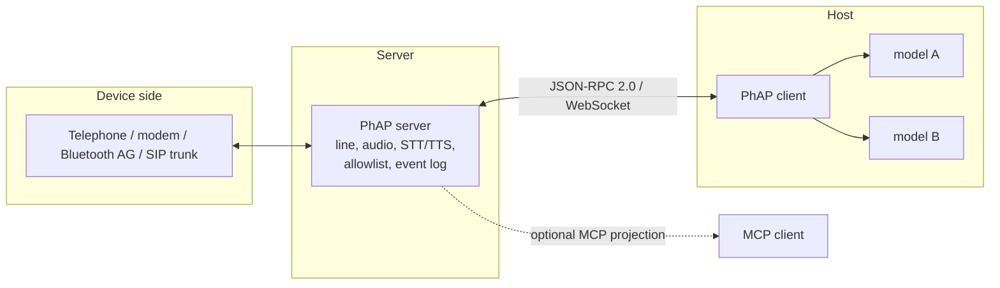

# Phone Agent Protocol Specification

**Protocol Revision:** `2026-10-27`
**Status:** Draft

## Overview

The Phone Agent Protocol (PhAP) is an open protocol that lets an agent host (an application that runs one or more language models) control a real telephone. Through it a host can:
- place and answer calls
- hold a live spoken conversation
- create conference calls
- send and read SMS messages
- search contacts

PhAP uses [JSON-RPC 2.0](https://www.jsonrpc.org/specification) messages carried over a [WebSocket](https://www.rfc-editor.org/rfc/rfc6455) connection between:

- **Servers**: services that own a telephone line and expose it through PhAP.
- **Clients**: agent hosts that connect to a server and decide how events are handled, including which model (if any) handles them.

PhAP complements the [Model Context Protocol](https://modelcontextprotocol.io) (MCP). MCP is client-initiated and request/response. PhAP is built for a resource that produces events on its own, such as an incoming call, and whose state outlives any single client connection.

The authoritative definition of every message is the JSON Schema at [`schema/2026-10-27/schema.json`](../../schema/2026-10-27/schema.json). If this prose and the schema conflict, the schema prevails for message structure and this prose prevails for behaviour.

## Key Words

The key words "MUST", "MUST NOT", "REQUIRED", "SHALL", "SHALL NOT", "SHOULD", "SHOULD NOT", "RECOMMENDED", "NOT RECOMMENDED", "MAY", and "OPTIONAL" in this document are to be interpreted as described in [BCP 14](https://datatracker.ietf.org/doc/html/bcp14) ([RFC 2119](https://datatracker.ietf.org/doc/html/rfc2119), [RFC 8174](https://datatracker.ietf.org/doc/html/rfc8174)) when, and only when, they appear in all capitals, as shown here.

## Terminology

| Term | Definition |
|---|---|
| **Server** | A PhAP endpoint that owns exactly one telephone line. It owns the link to the device, audio, speech recognition, speech synthesis and policy enforcement. |
| **Client** | A PhAP endpoint that connects to a server on behalf of an agent host. |
| **Session** | One authenticated WebSocket connection between a client and a server, from `hello` until the connection closes. |
| **Controller** | A client session that is permitted to invoke state-changing methods. At most one controller session exists at any time. |
| **Observer** | A client session that receives events and may invoke read-only methods only. |
| **Event** | A server-to-client notification carrying a monotonically increasing sequence number (`seq`). |
| **State-changing method** | A method marked ✱ in this specification. It alters the state of the line, a call, a message store or the engine. |
| **Allowlist** | The set of telephone numbers the server permits as the target of an outbound action. |
| **Untrusted content** | Any text that originates from a third party, such as caller speech, SMS bodies or contact names. |

## Architecture

A server MAY accept several sessions at once. Exactly one of them MAY be the controller; the others are observers.

## Design Principles

1. **The server enforces policy.** Allowlist checks, fallback policy and configuration MUST be enforced by the server. Clients and models are not trusted to enforce them.
2. **Events are pushed.** A client MUST NOT need to poll to learn about inbound calls or messages.
3. **State outlives sessions.** Calls continue across client disconnects. Sessions are resumable.
4. **Content is data.** Untrusted content is delivered as data and MUST NOT be interpreted as protocol instructions by any party.
5. **Small, typed surface.** Every method and event is specified and schema-validated. Extension happens through new capabilities, not free-form payloads.

## Specification Contents

- **Base protocol**
  - [Overview](basic/overview.md): message types and conventions
  - [Transports](basic/transports.md)
  - [Lifecycle](basic/lifecycle.md)
  - [Authorization](basic/authorization.md)
  - Utilities: [Heartbeat](basic/utilities/heartbeat.md), [Resumption](basic/utilities/resumption.md), [Idempotency](basic/utilities/idempotency.md)
- **Server features**
  - [Calls](server/calls.md)
  - [Conference](server/conference.md)
  - [SMS](server/sms.md)
  - [Contacts](server/contacts.md)
  - [Transcripts](server/transcripts.md)
  - [Engine](server/engine.md)
- **Reference**
  - [Errors](errors.md)
  - [Security considerations](security.md)
  - [MCP projection](mcp-projection.md)
  - [Configuration (non-normative)](configuration.md)

## Out of Scope for This Revision

The following are out of scope for this revision. Implementations MUST NOT advertise capabilities for them:
- raw audio streaming (the capability name `audio_stream` is reserved)
- interrupting synthesis in progress (barge-in)
- multiple lines per server
- waking MCP clients for inbound events

## Acknowledgements

- The structure and conventions of this specification are inspired by the [Model Context Protocol](https://modelcontextprotocol.io) specification. These include date-based revisions, the split into base protocol and features, and capability negotiation. No text has been copied from it.
- PhAP builds on:
  - [JSON-RPC 2.0](https://www.jsonrpc.org/specification)
  - [The WebSocket Protocol, RFC 6455](https://www.rfc-editor.org/rfc/rfc6455)
  - the requirement key words of [RFC 2119](https://datatracker.ietf.org/doc/html/rfc2119) and [RFC 8174](https://datatracker.ietf.org/doc/html/rfc8174)
  - [JSON Schema 2020-12](https://json-schema.org/draft/2020-12)
