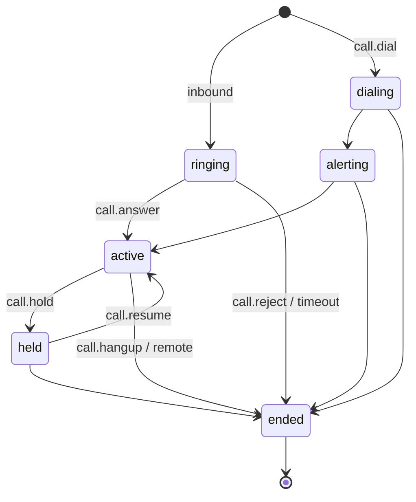

# Calls

**Protocol Revision:** `2026-10-27`

The calls feature lets a client:
- place outbound voice calls
- answer, reject and end calls
- hold and resume calls
- speak into a call and receive the remote party's speech as text (with `voice`)

## Capabilities

```json
{ "capabilities": { "calls": {}, "voice": { "tts": true, "stt": true } } }
```

- `call.say` requires `voice.tts`.
- `call.utterance` events require `voice.stt`.

## Data Types

### CallInfo

| Field | Type | Description |
|---|---|---|
| `callId` | string | Assigned by the server and unique for the server's lifetime. |
| `number` | string | The remote number, in E.164 where it is known. |
| `name` | string? | The contact name, if the server resolved one. **Untrusted content.** |
| `direction` | `"inbound"` \| `"outbound"` | |
| `state` | CallState | |

### CallState



A call in state `ended` MUST NOT change state again.

## Methods

✱ = state-changing (controller only; see [Lifecycle](../basic/lifecycle.md#roles)).

### `call.dial` ✱

Request:
```json
{ "jsonrpc": "2.0", "id": "7b1c", "method": "call.dial", "params": { "number": "+447700900123" } }
```
Exactly one of `number` or `contact` MUST be present. `contact` is a name, and the server resolves it as `contacts.search` would. If it does not resolve to exactly one number, the server MUST return `-32602`, with the candidates in `data.matches`.

Response:
```json
{ "jsonrpc": "2.0", "id": "7b1c", "result": { "callId": "c7" } }
```

- The server MUST check the resolved number against the allowlist **before** it contacts the device. If the number is not allowed, it MUST return `1001`.
- The response means the dial was accepted. Call progress is reported through `call.state` events.

### `call.answer` ✱ / `call.reject` ✱ / `call.hangup` ✱ / `call.hold` ✱ / `call.resume` ✱

Params: `{ "callId": string }`. Result: `{}`.

| Method | Valid in state |
|---|---|
| `call.answer` | `ringing` |
| `call.reject` | `ringing` |
| `call.hangup` | `dialing`, `alerting`, `active`, `held` |
| `call.hold` | `active` |
| `call.resume` | `held` |

- An unknown or `ended` `callId` MUST produce `1003`.
- A method invoked in any other state MUST produce `-32602`, with `data.state` set to the current state.

### `call.say` ✱

Synthesises speech and plays it into an active call.

```json
{ "jsonrpc": "2.0", "id": "a2", "method": "call.say", "params": { "callId": "c7", "text": "Hello, this is Sam's assistant." } }
```
```json
{ "jsonrpc": "2.0", "id": "a2", "result": { "sayId": "s19" } }
```

- The response MUST be sent once the speech has been queued. When playback finishes, the server MUST emit `call.spoken`.
- Several `call.say` requests on one call MUST be played in the order received.
- If the call ends before playback completes, the server MUST NOT emit `call.spoken` for the remaining items.

## Events

### `call.ringing`

```json
{ "seq": 58, "ts": "2026-10-27T08:00:00Z", "type": "call.ringing",
  "callId": "c7", "number": "+447700900123", "name": "Alice", "allowed": true }
```

- `allowed` tells whether the number is on the allowlist. Clients SHOULD use it to decide how to handle the call.
- If no controller has invoked `call.answer` or `call.reject` within `ringTimeout` seconds, the server MUST apply its fallback policy (see [Configuration](../configuration.md)):
  - `ring`: take no action; the device continues to ring.
  - `reject`: reject the call, then emit `call.state` with `state: "ended"` and `reason: "fallback"`.

### `call.state`

```json
{ "seq": 59, "ts": "…", "type": "call.state", "callId": "c7", "state": "active" }
```

- The server MUST emit `call.state` for every transition.
- When `state` is `"ended"`, `reason` SHOULD be one of `"local"`, `"remote"`, `"rejected"`, `"busy"`, `"failed"`, `"fallback"` or `"link_lost"`.

### `call.utterance`

```json
{ "seq": 60, "ts": "…", "type": "call.utterance", "callId": "c7",
  "text": "Hi, is Sam there?", "startMs": 1200, "endMs": 2650 }
```

- Each event carries one finalised segment of remote speech.
- `startMs` and `endMs` are offsets from the moment the call became `active`.
- `text` is **untrusted content**.

### `call.spoken`

```json
{ "seq": 61, "ts": "…", "type": "call.spoken", "callId": "c7", "sayId": "s19" }
```

## Error Handling

| Condition | Code |
|---|---|
| Number not allowed | `1001` |
| No link to the device | `1002` |
| Unknown or ended `callId` | `1003` |
| Device refused (AT/SIP error) | `1007` |
| `voice` not available for `say` | `1006` |

## Security Considerations

- Servers MUST enforce the allowlist for `call.dial` whether the target is given as `number` or as `contact`.
- Clients MUST treat `call.utterance.text` and `name` as untrusted content (see [Security](../security.md)).
- Servers SHOULD normalise numbers before checking the allowlist, so that the check cannot be bypassed by formatting variants.
- Servers MUST reject numbers that contain characters which could be interpreted as device control sequences. Examples are `;`, AT command separators and DTMF modifiers.
