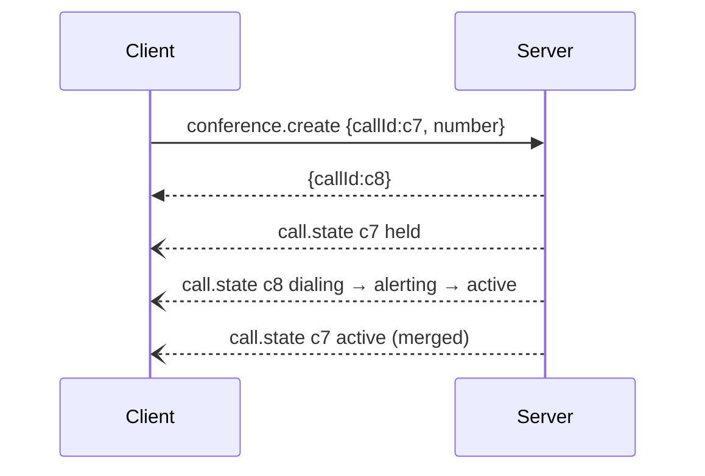

# Conference

**Protocol Revision:** `2026-10-27`

The conference feature merges calls into a multi-party call.

## Capabilities

```json
{ "capabilities": { "conference": {} } }
```

A server that declares `conference` MUST also declare `calls`.

## Methods

### `conference.create` ✱

Puts an active call on hold, dials a second party, and merges the two once the second party answers.

```json
{ "jsonrpc": "2.0", "id": "c1", "method": "conference.create",
  "params": { "callId": "c7", "number": "+447700900456" } }
```
```json
{ "jsonrpc": "2.0", "id": "c1", "result": { "callId": "c8" } }
```

- `callId` MUST identify a call in state `active`.
- `number` MUST pass the allowlist, or the server returns `1001`. `contact` MAY be given instead, as for `call.dial`.
- The result is the `callId` of the new leg. The server reports progress with `call.state` events for both legs.
- When the merge succeeds, both legs MUST be `active`. They MAY report `conference: true` in later `call.state` events.
- If the second leg fails, the server SHOULD resume the first leg and MUST emit the corresponding `call.state` events.



### `conference.join` ✱

Merges a call that is `held` or waiting into the current conversation.

```json
{ "jsonrpc": "2.0", "id": "c2", "method": "conference.join", "params": { "callId": "c9" } }
```

Result: `{}`. If `callId` is not in a mergeable state, the server MUST return `-32602`.

## Error Handling

| Condition | Code |
|---|---|
| Number not allowed | `1001` |
| Unknown call | `1003` |
| Device does not support merging | `1007` |

## Security Considerations

The allowlist applies to every leg a server dials.
